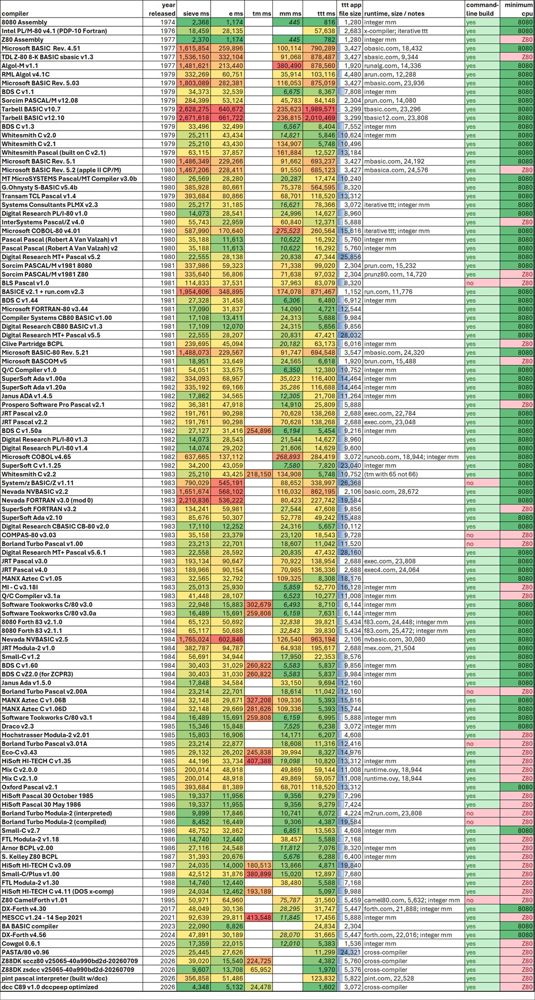

# cpm_compilers
CP/M 2.2 compilers, assemblers, and interpreters

The license for this repo applies to code I wrote for this repo including versions of the sieve, e, ttt, tm, and mm benchmarks and the build scripts to invoke the tools. The various CP/M 2.2 tools and documentation each have their own respective license terms. In a few cases I used the sieve benchmark that shipped with the tools, so obviously those copies fall under the license of the respective tool.

I do not own the copyright for any of these tools. This repo is simply an aggregation of the tools to ease testing of my NTVCM CP/M 2.2 emulator.

In some cases where required I've copied an assembler or linker that did not ship with a given compiler into folders so binaries can be produced. These tools belong to their respective owners.

These tools are available for download from many sites on the internet. They are often in forms that make their extraction and/or use difficult. This repo simplifies the process.

**If you own the copyright to any of these tools and want me to take them down, please let me know and I'll do so ASAP. It's not my intention to pirate anyone's software.**

I cannot vouch that any of these tools matches their official distribution form. Many of these were apparently taken from snapshots on peoples' machines through the years and include changes, files, and/or configuration not found in a pristine distribution. 

In some cases I've included user manuals in PDF form that I've found online for the various compilers. They sometimes match the version and sometimes not, but they are always helpful.

I can vouch that the m.bat and m.sh scripts in each folder builds working benchmark binaries.

It is my intention to show each tool in its best light with respect to the benchmarks. If you know of better optimization flags or ways to improve the benchmark source code for a given tool, please feel free to submit a pull request or open an issue. That said, I want to avoid cheap hacks like using peek/poke in BASIC instead of variables.

The benchmarks include:
  * sieve: The classic from BYTE Magazine that counts prime numbers. Measures array and loop performance.
  * e: Computes the irrational number e to 192 digits. Measures integer multiply/divide along with array and loop performance.
  * ttt: proves you can't win at tic-tac-toe if the opponent is competent. Measures function call and stack access along with array and loop performance.
  * tm: test malloc. This calls malloc/calloc/free/memset in the C runtime to measure performance. It's C-only and many compilers can't run it.
  * mm: matrix multiply. Jerry Pournelle's benchmark from the October 1982 BYTE Magazine multiplies two 20x20 matrices and sums the result. Measures floating point math and two-dimensional array indexing. A and B hold small whole numbers, so every floating point format computes the sum 465880 exactly (RML Algol's 3-byte mantissa gets 465879.8). Tools without floating point (and a few whose floating point doesn't work for this) run the same arithmetic with integers; the table's notes column says "integer mm" for those, and their times aren't comparable to the floating point ones.

The original BYTE listings of mm in BASIC and Pascal both have bugs, and not the same ones, that go unnoticed only because the benchmark's matrices are square. Both declare A as m x n, B as n x m, and C as m x m. In both, the multiply loop runs j to n and k to m when it should run j to m and k to n. The BASIC listing also fills B with the row and column bounds swapped, and fills and sums C with columns running to n instead of m; the Pascal listing gets those right. The code only works when all the dimensions are the same, like 20x20. The mm sources in this repo have those bugs fixed.

To run the compilers on Windows, use the m.bat script in each folder. e.g.:
  * m sieve
  * m e
  * m ttt
  * m mm

On Linux or MacOS use m.sh:
  * m.sh sieve
  * m.sh e
  * m.sh ttt
  * m.sh mm

To run the resulting apps, use NTVCM's -c flag to force console mode and -p flag to show performance information. The interpreters have other modes for running; see their respective m.bat/m.sh files for details.
  * ntvcm -c -p sieve
  * ntvcm -c -p e
  * ntvcm -c -p ttt

Many other CP/M 2.2 emulators will work in place of NTVCM. The tools in this repo are a good test of CP/M 2.2 BDOS compatibility; some rely on surprising (to me) BDOS behaviors.

The Borland Turbo Pascal v1, v2, and v3 build scripts use `TURBOCL.COM`. The Turbo Modula-2 scripts use `M2CL.COM`, which compiles and links a program module. Each folder includes a Python script to rebuild its command-line compiler from the original compiler binary.

The BLS Pascal v1.0 and COMPAS-80 v3.03 build scripts use `BLSPASCL.COM` and `COMPASCL.COM`. Run `m.bat sieve`, `m.bat e`, and `m.bat ttt` on Windows, or `./m.sh sieve`, `./m.sh e`, and `./m.sh ttt` on Linux or macOS. Each invocation produces a standalone `.COM`. The scripts accept a source basename or a `.PAS` filename. Run `python3 build_pascal_cli.py` in either folder to regenerate its command-line compiler.

The build scripts assume ntvcm is in your path. 

Linux systems generally have case-sensitive file systems and CP/M generally forces uppercase filenames. You're best off if you change all tool files, source files, and arguments to uppercase on Linux.

If you're running Linux or MacOS and see perplexing compilation errors or infinite loops in the compiler, it could be your source files don't have cr/lf line separators. Use unix2dos to add them; nearly all these compilers require them. Also, some compiler support/include text files require CR/LF; the BCPL compilers are good examples of this. If you clone this repo on non-Windows it's possible the CR characters were stripped and you need to add them back with unix2dos.

Some compilers require a ^Z / 0x1a at the end of files. Since CP/M text files end in ^z/0x1a, unix2dos requires -f to force the conversion of what it thinks is a binary file. You may need to append a ^z manually to get some compilers to work. Some compilers will go into an infinite loop looking for a ^z.

The BA compiler is in the [tic-tac-toe and its applicability to nuclear war](https://github.com/davidly/ttt) repo. It generates code for 6502, 8080, 8086, x86, x64, 68000, arm32, arm64, and 64-bit RISC-V.

The [dcc](https://github.com/davidly/dcc) C compiler (developed by me and Dave Glover) runs on Linux, MacOS, and Windows. It turns C89+ into a .mac file for m80 to assemble and l80 to link. It generates the smallest, fastest binaries of all the compilers. But it still can't beat good assembly :)

Intel PL/M-80 v4.1 is the 1976 cross-compiler, a Fortran program that ran on Tymshare's PDP-10s. The compiler isn't in this repo; the [plm80](https://github.com/davidly/ntvcm/tree/main/plm80) tools in the NTVCM repo recover it from an archived Tymshare tape and run it in a PDP-10 emulator. The "intel plm-80 v4.1" folder has the benchmark sources and notes. That version of PL/M has no recursion, so its ttt saves each level in arrays instead.

Here are runtimes for the benchmarks in milliseconds for a 4Mhz Z80 as emulated by [NTVCM](https://github.com/davidly/ntvcm/)

